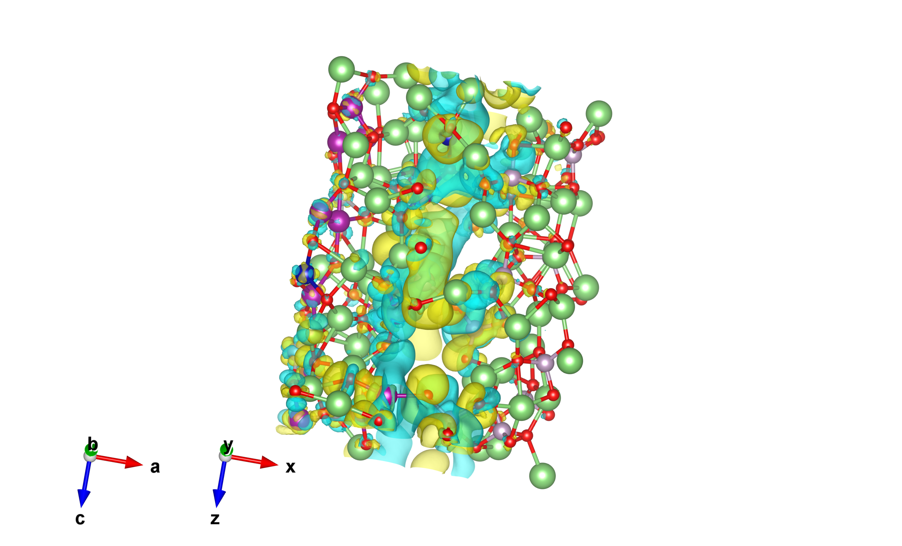
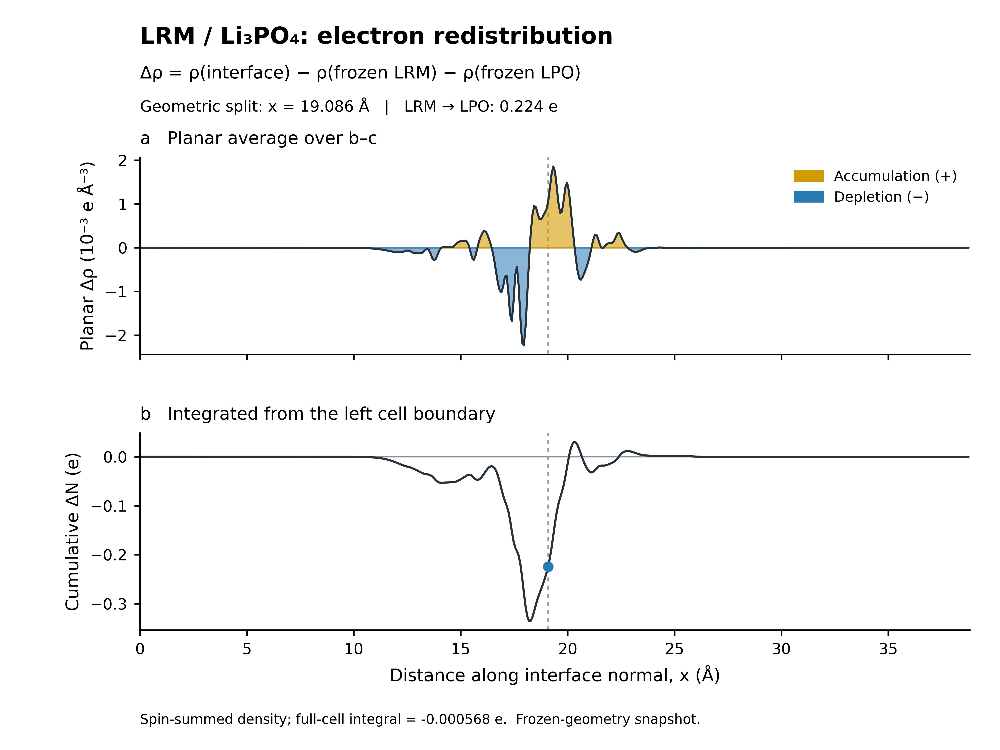

# LRM/LPO 冻结界面差分电荷密度结果分析报告

分析日期：2026年10月23日。计算作业：d8f1704e2d57414181c5c5b710d1b7cf。

本报告依据已有 ABACUS 输出、经过核验的密度积分及图像整理。本次未新增电子结构计算，未修改原始密度。

## 1. 核心结论

当前冻结构型中，LRM/LPO 接触后出现以界面附近为主的电子重排。以两片段最外侧原子之间的几何中点 x = 19.086441 Å 为分界，LRM 半空间电子数减少 0.224452 e，LPO 半空间增加 0.223884 e。因此，该分区下电子由 LRM 向 LPO 转移约 **0.224 e/模拟晶胞**。[S1]

这一结论受到三维正负等值面、界面法向平面平均和半空间体积分的共同支持。分界面在两侧最外层原子之间移动时，LPO 得电子量为 0.168–0.257 e；在已测试分界面处，转移方向均保持 LRM → LPO。该范围反映空间分区敏感性，不是统计置信区间。[S1]

上述结果描述给定构型相对于冻结片段参照的电子重排，不直接给出原子氧化态、Bader 电荷、电势阶跃、化学键强度或 Li 迁移势垒，也不能单独证明界面已达到结构平衡。[S1–S3]

## 2. 研究对象与计算方法

| 标记 | 计算体系 | 原子数 | 实际组成 |
|---|---|---:|---|
| A | 完整界面 A_heterojunction | 192 | Li₆₅Mn₁₃Co₃Ni₃P₁₂O₉₆ |
| B1 | LRM 冻结片段 B1_LRM_frozen_coord | 97 | Li₃₀Mn₁₃Co₃Ni₃O₄₈ |
| C1 | LPO 冻结片段 C1_LPO_frozen_coord | 95 | Li₃₅P₁₂O₄₈ |

LRM 和 LPO 沿用原项目标记。LPO 为项目中标记为 Li₃PO₄ 的磷酸锂侧，但本次有限片段实际为 Li₃₅P₁₂O₄₈，相比 12 个 Li₃PO₄ 化学式单位少一个 Li。这是组成事实，不能据此指定缺陷电荷态，也不能将该片段等同于理想体相 Li₃PO₄。结果向其他化学计量比或终止面的推广需要另行验证。[S1]

B1 和 C1 的原子合并后与 A 逐一匹配：97 + 95 = 192，坐标最大匹配偏差为 0 Å，无遗漏或重复。两片段保持界面内的原子坐标及相同晶胞，因此该差分不包含另行弛豫片段造成的几何变化贡献。[S1,S3]

共同设置为 ABACUS/LCAO、PBE、自旋极化 nspin = 2、DFT+U、D3(BJ)，ecutwfc = 100 Ry，Gamma 中心 1 × 3 × 2 k 点网格，Gaussian 展宽参数 0.002 Ry，scf_thr = 1 × 10⁻⁷。Mn、Co、Ni 的 U 参数分别为 3.9、3.3、6.2 eV。共享元素的赝势与数值轨道文件已按哈希核对一致。[S3,S7]

## 3. 差分定义与单位

采用两自旋通道求和后的电子数密度：

Δρ(r) = [ρ↑(r) + ρ↓(r)]A − [ρ↑(r) + ρ↓(r)]B1 − [ρ↑(r) + ρ↓(r)]C1。

- Δρ > 0：相对于冻结片段密度之和，电子积累。
- Δρ < 0：相对于同一参照，电子耗尽。
- 本报告的正负号表示电子数增减；若表示带符号电荷变化，则电子贡献为 Δq = −eΔN。
- 这里分析的是总电子密度差，不是自旋密度差，也不是相对于中性自由原子的形变密度。

三套网格均为 480 × 125 × 216，共 12,960,000 点，原点及网格向量一致。CUBE 原始坐标单位为 Bohr，密度单位为 e/Bohr³；图中使用 Å 和 e/ų。三维等值面阈值为 ±0.003 e/ų，对应原始 CUBE 数值约 ±0.000444554 e/Bohr³。[S1,S3]

界面法向为 x 方向，b–c 截面积 S = 174.992714 Ų。平面平均与累计积分定义为：

Δρ̄(x) = (1/S) ∫∫S Δρ(x,y,z)dS；

ΔN(x) = S ∫左边界ˣ Δρ̄(x′)dx′。

离散坐标采用 CUBE 原点 + iΔx。分界面穿过体元时，按体元在两半空间内的长度比例分配积分。积分覆盖完整网格，不受绘图阈值、透明度、视角或真空裁切影响。[S3]

## 4. 数据质量与电子数守恒

### 4.1 SCF 收敛

| 体系 | SCF 步数 | 最后 drho | 电子收敛 | 正常结束 |
|---|---:|---:|---|---|
| A：完整界面 | 185 | 9.7513 × 10⁻⁸ | 是 | 是 |
| B1：LRM 片段 | 341 | 9.6214 × 10⁻⁸ | 是 | 是 |
| C1：LPO 片段 | 63 | 4.6139 × 10⁻⁸ | 是 | 是 |

指标来自已有 abacustest 提取结果。电子 SCF 收敛不等同于几何力收敛，也不等同于差分密度的基组、k 点和网格独立收敛。[S2]

### 4.2 密度积分

| 体系 | 赝势定义的预期电子数 | 按精确 STRU 晶胞积分 | 按 CUBE 头部体元积分 |
|---|---:|---:|---:|
| A | 1131 | 1130.999924 | 1131.005123 |
| B1 | 678 | 678.000409 | 678.003525 |
| C1 | 453 | 453.000083 | 453.002165 |

以上为所用赝势包含的电子数，不是全电子原子序数总和。CUBE 头部轴向量的小数位截断使体元产生约 4.597 ppm 的相对误差，解释了两种体元口径下的小偏差。[S1]

全空间差分积分为 **−0.000567757 e**，约为 LPO 半空间得电子量的 0.254%，远小于约 0.224 e 的净转移尺度。这支持近似电子数守恒，但不能作为全部计算误差的估计。本次未减去常数背景或强制将积分归零。[S1,S3]

## 5. 结果分析

### 5.1 三维电子重排

在 ±0.003 e/ų 阈值下，界面附近呈现相邻的电子积累与耗尽区域。VESTA 图中黄色为积累、青色为耗尽；Python 图采用金色和蓝色表示相同符号。该分布说明界面接触改变了局部电子密度，包含跨分区净转移及局部极化/重排。[S1,S3]

图1｜冻结界面的差分电子密度，阈值 ±0.003 e/ų。关闭了晶胞框线和截面填色，原始密度与原子坐标未变。

| 指标 | 积分值 | 含义 |
|---|---:|---|
| ∫max(Δρ,0)dV | +2.242038 e | 全空间正密度重排量 |
| ∫min(Δρ,0)dV | −2.242606 e | 全空间负密度重排量 |
| 两者之和 | −0.000567757 e | 全空间残差 |

约 2.24 e 的正、负重排量明显大于跨半空间的约 0.224 e，说明有大量局部重排相互抵消。因此，不能将全部正密度积分解释为两相之间转移了 2.24 e。[S1]

### 5.2 平面平均密度

| 特征 | 位置 x（Å） | Δρ̄（e/ų） | 位置归属 |
|---|---:|---:|---|
| 主耗尽峰 | 17.9550 | −0.00223197 | 几何分界面的 LRM 侧 |
| 主积累峰 | 19.3299 | +0.00185766 | 几何分界面的 LPO 侧 |

主耗尽峰和主积累峰位于分界面两侧，与 LRM 失电子、LPO 得电子的积分方向一致。曲线中的次级正负振荡表明，重排具有空间不均匀性，不能将两侧简化为均匀带电薄层。[S1]

已有独立复核显示，x = 16–22 Å 区间贡献了约 **86.4% 的平面平均密度绝对积分**，即 ∫区间|Δρ̄|dx / ∫全胞|Δρ̄|dx。这支持主要法向平均响应集中于界面附近。由于平面平均会抵消面内正负信号，该百分比不是三维 ∫|Δρ|dV 的空间占比。[S4]

图2｜b–c 平面平均差分密度和从左侧晶胞边界累计的电子数变化。虚线为几何分界，点标记该分区下的 LRM 积分。累计曲线的其他极值对应其他切分位置，不是唯一的界面转移量。

### 5.3 净电子转移

| 区域 | ΔN（e/模拟晶胞） | 含义 |
|---|---:|---|
| LRM 半空间，x < 19.086440638 Å | −0.224451629 | 净失电子 |
| LPO 半空间，x ≥ 19.086440638 Å | +0.223883872 | 净得电子 |
| 全晶胞 | −0.000567757 | 近似守恒残差 |

按共同有效精度，净转移为 **LRM → LPO，约 0.224 e/模拟晶胞**。两侧绝对值的小差异对应全空间残差，未作人为配平。按截面积归一化，LPO 得电子量为约 **1.279 × 10⁻³ e/Ų**，即 **0.1279 e/nm²**；该量仍采用相同半空间定义，不是 Bader 原子电荷。[S1]

结果支持具有方向性的界面电子重新分配。它尚未量化电势阶跃、功函数变化或内建电场；这些问题需要进一步结合静电势分析。

### 5.4 分区敏感性及旧结果核对

| 分界位置 x（Å） | LPO 半空间 ΔN（e） |
|---:|---:|
| 18.866681 | +0.256940 |
| 18.939934 | +0.247039 |
| 19.013187 | +0.236238 |
| 19.086441 | +0.223884 |
| 19.159694 | +0.208815 |
| 19.232947 | +0.190109 |
| 19.306200 | +0.168010 |

所测试分界面处方向一致，数值随分区变化。因此，应保留“几何半空间积分”的限定，不将 0.224 e 称为与分区无关的唯一值。[S1]

旧报告约 0.232 e 的结果可由半网格坐标平移和整层筛选积分复现：旧脚本坐标偏移 0.040439 Å，得到 LRM 积分 −0.231673 e；当前采用 CUBE 原点、几何中点及边界体元比例积分。差异来自坐标与离散积分口径，不表示转移方向反转。[S4]

## 6. 图像边界说明

旧 VESTA 图的黑色方框为晶胞轮廓，亮绿色平面为独立的截面填色。关闭后相关强烈边界消失。沿 y/z 仍可见部分切口，是等值面跨越周期边界后被单晶胞显示范围截断，不能解释为真实真空表面或电子密度突然为零。[S5]

沿 x 方向裁去远端真空时，两处检查面约为 10.838 Å 和 27.984 Å，最大 |Δρ| 分别为 1.228 × 10⁻⁴ 和 3.373 × 10⁻⁶ e/ų，均低于 0.003 e/ų 阈值，因此没有切到所显示的等值面。定量积分仍覆盖完整晶胞。[S3,S5]

## 7. 适用范围与必要的后续证据

1. **构型范围。** 当前为冻结构型的电子分析。SCF 设置 cal_force = 0，提取的力为 null，不能由这些输出重新验收力收敛。最短过渡金属–O 距离为 1.678847 Å，应结合实际配位及原始优化记录审查；单凭短键既不能判定结构错误，也不能证明界面稳定。[S1,S2,S7]
2. **数值与参照范围。** 本次未新增对差分密度的 k 点、FFT 网格、基组或磁态参照的系统收敛测试。片段采用各自保留原子的 LCAO 基组，未做 ghost-basis 或基组误差评估。结论限于所用设置与参照。[S3]
3. **原子归属。** 未执行 Bader 分区，不能从颜色指定某个 Mn、Co、Ni、O 或 P 的净得失电子数或氧化态，也未采用旧报告中的自建 Bader 算法结果。具体原子归属需要经核验的原子分区分析。[S3]
4. **性能推断。** 当前结果不能单独推出界面结合更强、循环稳定性提高或 Li 迁移势垒降低。这些结论分别需要一致参照下的能量、稳定性或迁移路径与能垒证据。

## 8. 可用于论文或汇报的结果表述

为考察 LRM/LPO 界面接触引起的电子重排，以保持相同晶胞及界面内原子坐标的冻结片段为参照，计算了自旋求和差分电子密度 Δρ = ρ界面 − ρLRM − ρLPO。正负等值面和平面平均结果表明，电子重排主要集中在界面附近。沿界面法向，主电子耗尽峰位于 LRM 侧 x = 17.955 Å，主电子积累峰位于 LPO 侧 x = 19.330 Å。以 x = 19.086 Å 的几何中点为分界，LRM 与 LPO 半空间的电子数变化分别为 −0.22445 e 和 +0.22388 e，表明该分区下电子由 LRM 向 LPO 转移约 0.224 e/模拟晶胞。分界面在两侧最外层原子之间变化时，方向保持一致，LPO 得电子量为 0.168–0.257 e，反映其对空间分区的依赖。结果支持所研究冻结构型中的界面电子重排与电荷分离，不能直接等同于原子氧化态变化或平衡界面的输运性质。

## 9. 证据与文件索引

本报告引用本项目实际数据与分析记录，未引入外部文献数值。

- [S1] charge_analysis.json（原始文件未随展示包发布）：组成、网格、单位、电子数校验、积分、分区敏感性与峰值。
- [S2] scf_metrics.json（原始文件未随展示包发布）：已有 abacustest 提取结果。
- [S3] 分析脚本（原始文件未随展示包发布）及[原分析记录](%E5%B7%AE%E5%88%86%E7%94%B5%E8%8D%B7%E5%88%86%E6%9E%90%E6%8A%A5%E5%91%8A.md)：定义、匹配检查、积分算法和计算范围。
- [S4] comparison_audit.json（原始文件未随展示包发布）：旧数值及界面区间占比复核。
- [S5] boundary_display_check.json（原始文件未随展示包发布）：显示边界检查。
- [S6] planar_charge.csv（原始文件未随展示包发布）：完整平面平均及逐层积分数据。
- [S7] 界面 INPUT（原始文件未随展示包发布）、界面 KPT（原始文件未随展示包发布）及输入哈希记录（原始文件未随展示包发布）：计算参数与来源。

### 可直接使用的三维数据

- 差分密度 CUBE（原始文件未随展示包发布）。
- 完整界面总密度（原始文件未随展示包发布）。
- LRM 冻结片段总密度（原始文件未随展示包发布）。
- LPO 冻结片段总密度（原始文件未随展示包发布）。
- 调整后的 VESTA 工程（原始文件未随展示包发布）。

### 结论—证据对应

| 结论 | 证据 | 状态 |
|---|---|---|
| 所选分区下 LRM 向 LPO 转移电子 | 两半空间积分的符号和数值 | 支持；限于该构型与参照 |
| 主要法向平均重排位于界面附近 | 平均峰及 16–22 Å 区间占比 | 支持；非三维绝对重排占比 |
| 已测试分界面处转移方向一致 | 七个分界位置的积分同号 | 支持；不代表数值参数独立收敛 |
| 特定原子氧化态变化或输运改善 | 无相应证据 | 未建立 |

术语约定：LRM/LPO 沿用项目标记；Δρ 为自旋求和的差分电子数密度；ΔN 为选定空间内电子数变化；所有约 0.224 e 的表述均指每个模拟晶胞的几何半空间积分。
