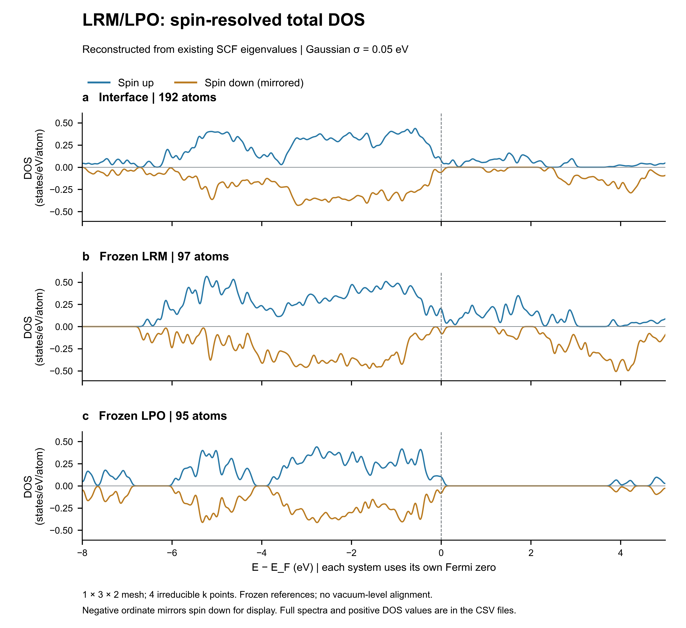
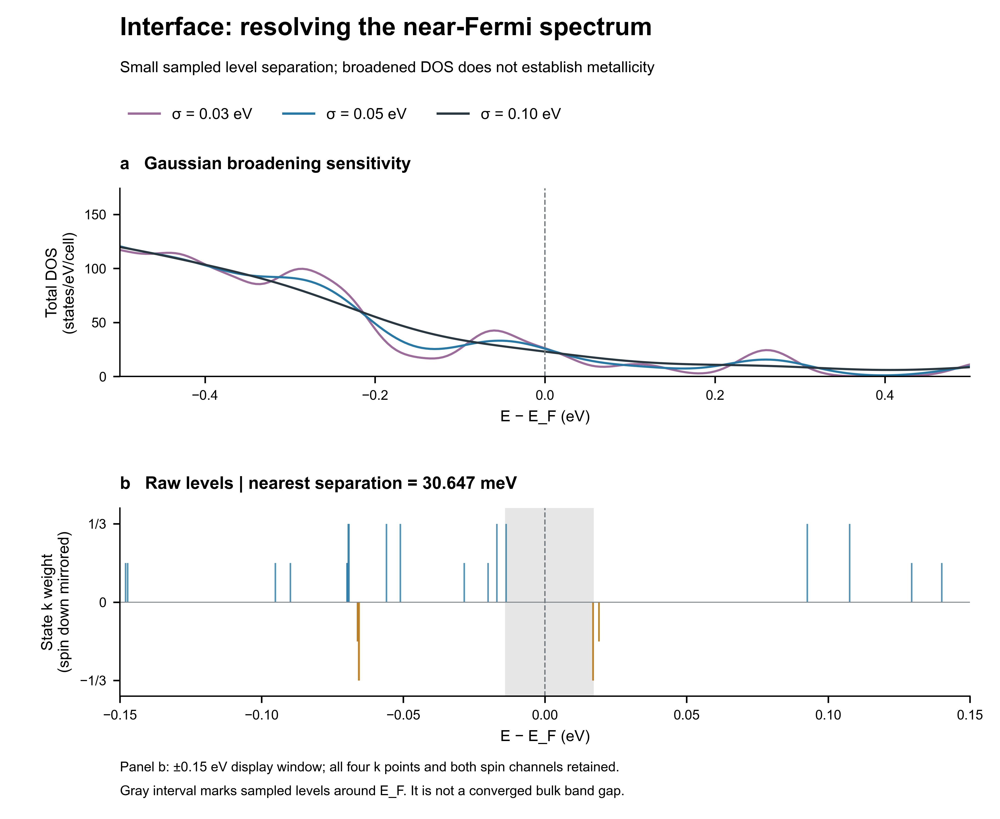

# LRM/LPO 界面 DOS 分析报告

日期：2026年10月23日。父作业：d8f1704e2d57414181c5c5b710d1b7cf。

## 1. 本次实际完成的工作

本次完成的是**基于已有收敛 SCF 本征值重建的自旋分辨总态密度（TDOS）分析**，包括完整界面、LRM 冻结片段、LPO 冻结片段及更严格 SCF 阈值的界面对照。原始有效 INPUT 中 out_dos = 0，输出目录没有 DOS/PDOS 文件，因此没有将本次后处理冒充为新的密 k 点 DOS 计算。没有提交新的付费计算，也没有生成缺乏投影系数支撑的元素或轨道 PDOS。

关键结论是：界面在当前离散 k 网格上存在靠近费米能级的电子态，上下自旋分布不对称；最近的费米能级两侧采样态相隔约 **0.030647 eV**。这一间隔小于本次主绘图 Gaussian 的标准差 0.05 eV，且原计算使用 1 × 3 × 2 k 网格和有限占据展宽，所以不能只依据展宽后的有限 D(E_F) 判定界面为金属，也不能将 0.030647 eV 作为已收敛的材料带隙。[D1–D3]

## 2. 数据与处理方法

ABACUS 版本为 v3.10.1(f71921fe8 (Fri Nov 21 13:49:34 2025 +0800))。体系和冻结片段沿用差分电荷分析中的结构、PBE+U、自旋与基组设置。主体系为 192 原子；B1 和 C1 分别为 97 和 95 原子。LPO 片段的实际组成为 Li₃₅P₁₂O₄₈，不能当作理想体相 Li₃PO₄。

通过 abacustest RESULT 提取最终日志中的本征值、费米能级、电子数、磁矩及收敛指标；另解析 istate.info 独立核对。两套本征值的最大偏差小于 0.001 eV，与文本输出精度差异相符，最终使用 abacustest 提取的较高精度本征值。占据数来自 istate.info，其 Occupation 列已经包含 k 点权重；电子数检查时没有再次乘权重。[D1,D4]

完整 k 网格包含 6 点，输出的 4 个不可约 k 点的简并数为 1、2、1、2，权重为 1/6、1/3、1/6、1/3。本次从完整网格到不可约网格的映射恢复精确权重，未直接使用 kpoints 中仅保留四位小数的权重。[D1,D4]

每个自旋的 DOS 定义为：

Dσ(E) = Σₙₖ wₖ · exp[−(E − εₙₖσ)²/(2s²)] / (s√(2π))。

这里 s 为 Gaussian **标准差**，主图 s = 0.05 eV，并检查 s = 0.03 和 0.10 eV；它是本次后处理定义，不能不加核对地等同于任意软件同名的展宽参数。两自旋分别计数，每态自旋简并因子为 1。**总 DOS 不乘费米占据数**，否则会把未占据态错误滤除。谱图能量步长为 0.005 eV，主图窗口为 E − E_F = −8 至 +5 eV；完整计算能区的 DOS 另存 CSV，所有 k 点、两自旋及已计算的全部能带均纳入重建。[D2,D4]

为比较不同原子数的体系，主比较图使用 states/eV/atom。近费米能级图和积分校验使用 states/eV/模拟晶胞。下自旋在图上取负值只是镜像显示，CSV 中两自旋 DOS 均为非负数。**三个体系分别以自身 E_F 为零点**；图中的峰位不能作为真空对齐能级或能带偏移，三个 DOS 也不能直接相减来解释电荷转移。[D2,D5]

## 3. 主要结果

| 体系 | 原子数 | 总自旋磁矩（μB/胞） | 采样网格间隔指标（eV） | D(E_F)（states/eV/胞） | D(E_F)（states/eV/atom） |
|---|---:|---:|---:|---:|---:|
| 完整界面 A | 192 | 34.640131 | 0.030647 | 25.6918 | 0.133812 |
| LRM 冻结片段 B1 | 97 | 33.666269 | 0（有带穿过 E_F） | 26.9252 | 0.277579 |
| LPO 冻结片段 C1 | 95 | -0.320741 | 0.014600 | 17.5204 | 0.184426 |

表中 D(E_F) 对应标准差 0.05 eV，并非不依赖展宽的材料常数。“采样网格间隔指标”在发现同一自旋带跨越 E_F 时记为 0，否则记为当前已采样能级中 E_F 两侧最近值之差，不是光学带隙或经过 k 点收敛的基本带隙。[D1,D2]

图1｜完整界面及两个冻结片段的自旋分辨总 DOS。蓝色为上自旋，金色为下自旋的镜像；使用各自 E_F 为零点并按实际原子数归一化。主 Gaussian 标准差为 0.05 eV。

### 3.1 完整界面

界面最近的 E_F 以下本征值为 −0.013741 eV，最近的 E_F 以上本征值为 +0.016906 eV，二者间隔 30.647 meV。在已采样的四个不可约 k 点，上自旋 E_F 以下能带数均为 583，下自旋均为 548；未发现同一能带在这些采样点间跨越 E_F。但上下自旋各有部分占据态，且没有覆盖连续布里渊区，不能由此给出零温绝缘性或金属性的最终判断。[D1,D2]

标准差 0.05 eV 时，界面 D↑(E_F) = 14.8472、D↓(E_F) = 10.8447，总和为 25.6918 states/eV/胞。这些是附近离散能级展宽后的谱权重，不能把两者之差解释成电荷转移量或传输自旋极化。总自旋磁矩为 34.640131 μB/胞，支持当前计算磁态中存在自旋不对称，但本次没有比较其他磁序。[D1,D2]

### 3.2 LRM 冻结片段

LRM 上自旋第 356 条能带在已采样 k 点的 E − E_F 范围为 −0.019806 至 +0.002204 eV，出现穿越 E_F 的证据；因此不能把两个相邻离散态之间约 5 meV 的间隔误报为带隙。其下自旋最近的 E_F 以下和以上态分别为 −0.262002 与 +0.016643 eV。当前结果显示两个自旋通道的低能谱不同，但仍受原 k 网格、占据展宽及冻结表面参照的限制，未作半金属分类。[D2]

### 3.3 LPO 冻结片段

LPO 最近的 E_F 以下态为 −0.007202 eV、以上态为 +0.007398 eV，分属不同自旋通道；二者间隔仅 14.600 meV。下自旋的下一高能态则在 +3.822436 eV，说明近 E_F 的自旋边缘态和较远的高能态不能用一个展宽后“空白区”简单概括。[D2]

这个 Li₃₅P₁₂O₄₈ 冻结片段具有 453 个赝势电子和有限表面，不是独立优化的理想体相 Li₃PO₄。当前数据不能据此宣布体相 Li₃PO₄ 为金属，也不能在没有投影信息时将这些态归属为确定的 Li 缺位态、O-p 态或某一表面原子态。[D1,D2]

## 4. 展宽与收敛检查

### 4.1 Gaussian 标准差敏感性

| Gaussian 标准差（eV） | 界面 D(E_F) | LRM D(E_F) | LPO D(E_F) |
|---:|---:|---:|---:|
| 0.03 | 26.1264 | 36.7531 | 25.8590 |
| 0.05 | 25.6918 | 26.9252 | 17.5204 |
| 0.10 | 22.9771 | 17.7056 | 12.8600 |

单位均为 states/eV/模拟晶胞。三个体系的 D(E_F) 随展宽改变；特别是 LRM 和 LPO 的数值变化明显，说明窄峰及近费米谱权重对绘图分辨率敏感。这不是统计不确定度，不能将其中某个数值当作不受后处理影响的结果。[D2]

图2｜上图比较三种 Gaussian 标准差；下图直接显示 ±0.15 eV 内的原始能级及 k 点权重。灰区仅标记已采样能级在 E_F 两侧的最近间隔。窄间隔会被有限宽度的 Gaussian 尾部填充，因此 D(E_F) > 0 与采样态之间有小间隔并不矛盾。

### 4.2 更严格 SCF 阈值对照

已有 A2 对照采用相同 STRU 与 KPT，将 scf_thr 从 1 × 10⁻⁷ 收紧至 1 × 10⁻⁸；其他输入差异仅为输出前缀和是否输出电荷密度。相对于各自 E_F 的全部对应本征值最大变化为 0.00007622 eV；近费米间隔从 0.030647 变为 0.030648 eV。标准差 0.05 eV 下，D(E_F) 从 25.691827 变为 25.691471 states/eV/胞。[D2]

因此，本次近费米特征对这一 SCF 阈值收紧变化很小。它不能替代 k 点、基组、占据展宽或磁态收敛检查；原计算的 Gaussian 占据展宽参数 0.002 Ry 对应约 0.0272 eV 的能量尺度，与界面 0.0306 eV 的间隔相近，也需要在进一步分类电子性质时核查。

### 4.3 电子数与态数求和规则

| 体系 | 预期赝势电子数 | 从加权占据数求和 | 残差（e） | 每自旋计算能带数 |
|---|---:|---:|---:|---:|
| 完整界面 A | 1131 | 1131.000000158 | +1.58e-07 | 699 |
| LRM 冻结片段 B1 | 678 | 678.000000370 | +3.70e-07 | 427 |
| LPO 冻结片段 C1 | 453 | 452.999998100 | -1.90e-06 | 272 |

两自旋全计算能区 DOS 的积分分别回到对应的 699/427/272 个已计算态，误差小于 10⁻⁶ 态；占据数求和与预期电子数的偏差小于 2 × 10⁻⁶ e。这个校验排除了重复计入自旋简并或 k 权重等归一化错误，但不能证明 k 网格足够致密。已计算最高能带在所有 k 点均高于各自 E_F + 7.33 eV，因此主图 +5 eV 上限没有触及本次已计算能带的截断边缘。[D1,D2]

## 5. 与差分电荷结果的关系

前一阶段的空间积分得到 LRM → LPO 约 0.224 e/模拟晶胞，定义依赖几何半空间。当前 DOS 给出能量分布及自旋不对称，两者回答的问题不同：电荷差说明密度在空间中如何变化，而总 DOS 不能确定这些变化来自哪些原子或轨道。

在相同 0.05 eV 后处理标准差下，界面单位原子的 D(E_F) 为 0.133812，低于两个冻结片段分别的 0.277579 和 0.184426。这个描述仅限于各自费米零点和既定展宽，不足以说明导电性提高或降低，也不足以从总 DOS 定量解释约 0.224 e 的转移。尚不能据此断言形成了某种 Mn/Co/Ni-d 与 O-p 杂化。[D2]

## 6. 尚未完成的轨道分辨问题

现有输出没有可用 PDOS 或波函数轨道投影系数。Orbitals/Orbital 基函数标签和 Mulliken 积分布居并不提供能量分辨投影，不能代替 PDOS。以下问题需要补充带投影输出的计算后才能回答：

- E_F 附近主要由 Mn、Co、Ni、O、P 或 Li 的哪些轨道贡献；
- 界面 LRM 侧与 LPO 侧、界面原子层与远离界面层的分辨 DOS；
- 过渡金属 d 与 O-p 态是否在同一能区呈现支持杂化的投影特征；
- 在更密 k 网格下，小间隔和近费米峰是否保持。

后续计算应继承已核实结构和物理模型，保留自旋及 DFT+U 状态，检查所用 ABACUS 版本的投影输出与重启要求，并以增加界面内 k 采样的候选网格做收敛对照。该步骤尚未执行，本次未擅自提交新的付费作业。当前总 DOS 产物可独立复核，不依赖等待新任务。

## 7. 可用于阶段报告的结果表述

基于已有收敛自旋极化 SCF 本征值及精确 k 点权重，重建了 LRM/LPO 冻结界面的自旋分辨总态密度。结果显示，界面两自旋通道在费米能级附近存在不对称谱权重，当前 k 网格上费米能级两侧最近采样态的间隔为 0.030647 eV。该特征在将 SCF 阈值从 10⁻⁷ 收紧至 10⁻⁸ 后变化很小，但有限展宽会填充这一窄间隔，因此尚不能据此确定收敛的金属/半导体分类。LRM 冻结片段的上自旋能带在已采样 k 点之间穿越费米能级；非理想化学计量比的 LPO 冻结片段也具有近费米边缘态。结合前述差分电荷结果，当前证据支持界面电子重排及自旋不对称的电子结构，而具体原子轨道贡献、杂化及能带对齐仍需进一步的投影态密度与共同能量参照分析。

## 8. 数据与复算文件

- [D1] 收敛、费米能级及电子数提取结果（原始文件未随展示包发布）。
- [D2] DOS 定量结果、展宽敏感性与 SCF 对照（原始文件未随展示包发布）。
- [D3] 本次执行范围（原始文件未随展示包发布）。
- [D4] 提取与交叉校验脚本（原始文件未随展示包发布）、DOS 重建脚本（原始文件未随展示包发布）及 源文件哈希（原始文件未随展示包发布）。
- [D5] Python 绘图脚本（原始文件未随展示包发布）及 绘图数据约定（原始文件未随展示包发布）。
- 界面 DOS 曲线 CSV（原始文件未随展示包发布）；界面完整已计算能区 DOS（原始文件未随展示包发布）；各体系近费米原始能级（原始文件未随展示包发布）。
- [自旋 DOS 比较 PDF](dos_spin_comparison.pdf)与 [近费米细节 PDF](dos_near_fermi_audit.pdf)；同目录提供 PNG 和可编辑 SVG。

## 附表：各自旋的近费米能级

| 体系 | 自旋通道 | E_F 以下最近态（eV） | E_F 以上最近态（eV） | 四个 k 点 E_F 以下带数 |
|---|---:|---:|---:|---|
| 完整界面 A | 1 | -0.013741 | 0.092516 | [583, 583, 583, 583] |
| 完整界面 A | 2 | -0.065677 | 0.016906 | [548, 548, 548, 548] |
| LRM 冻结片段 B1 | 1 | -0.002978 | 0.002204 | [356, 356, 355, 356] |
| LRM 冻结片段 B1 | 2 | -0.262002 | 0.016643 | [322, 322, 322, 322] |
| LPO 冻结片段 C1 | 1 | -0.086602 | 0.007398 | [226, 226, 226, 226] |
| LPO 冻结片段 C1 | 2 | -0.007202 | 3.822436 | [227, 227, 227, 227] |

通道 1/2 对应原计算的上/下自旋方向，不能在没有局域磁序分析时将其等同于特定元素的局域磁矩方向。
