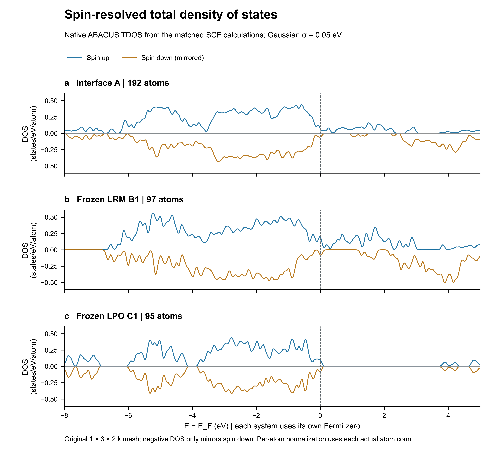
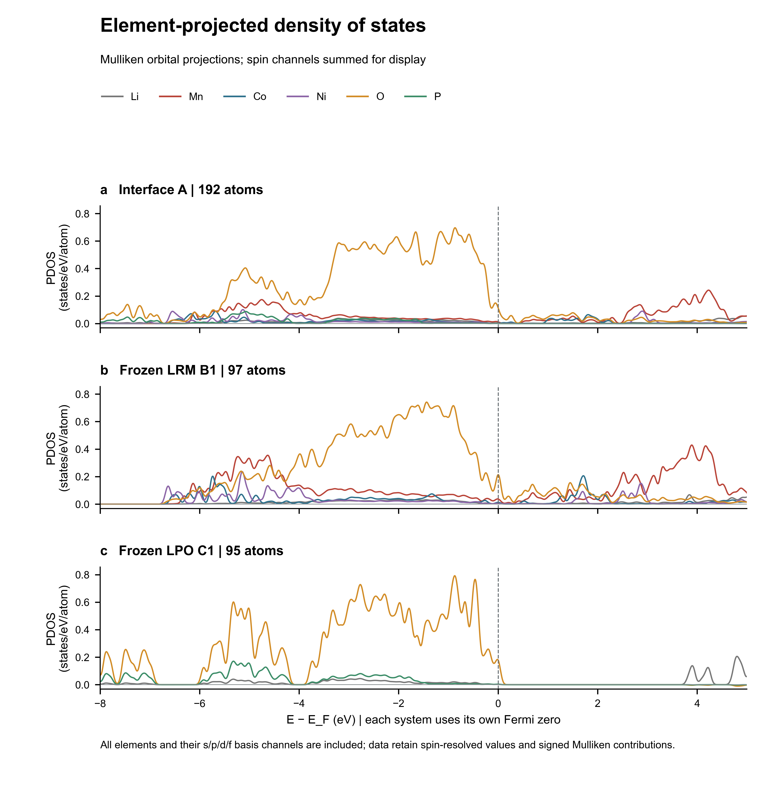
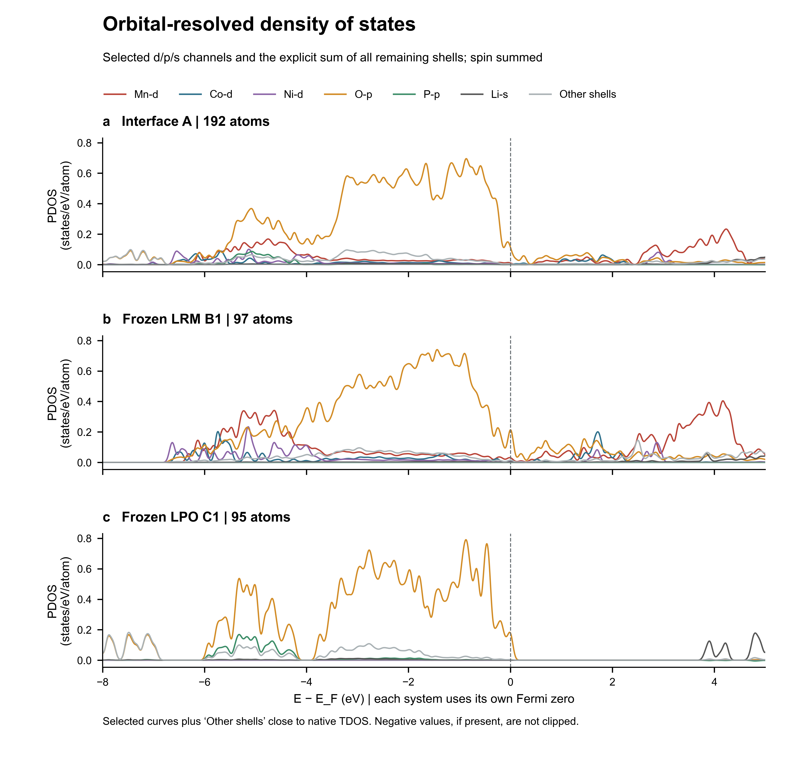
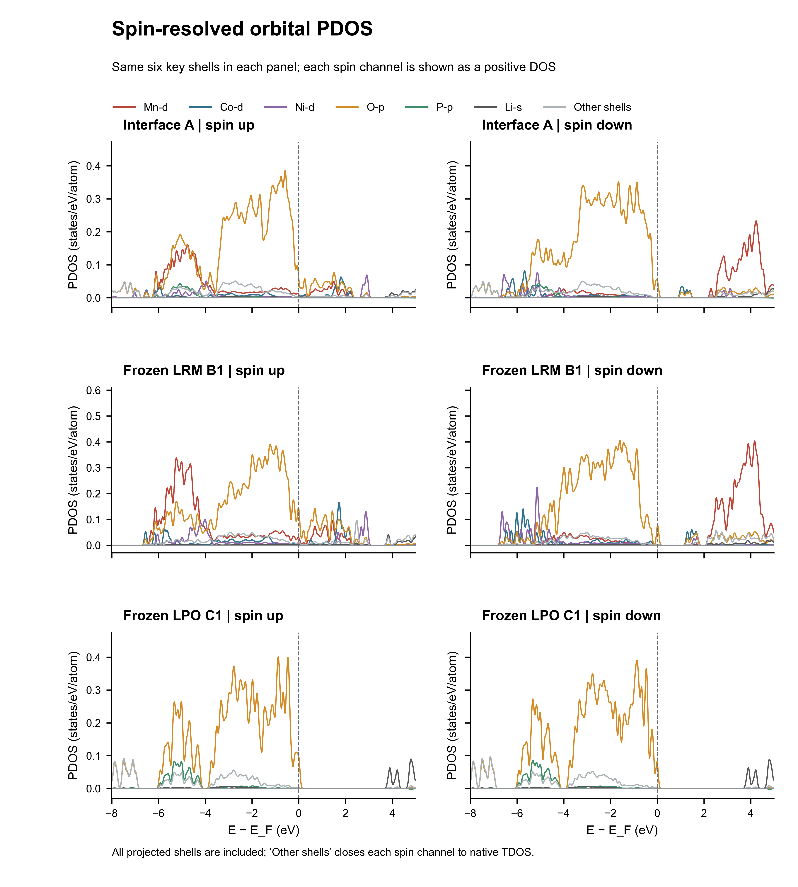
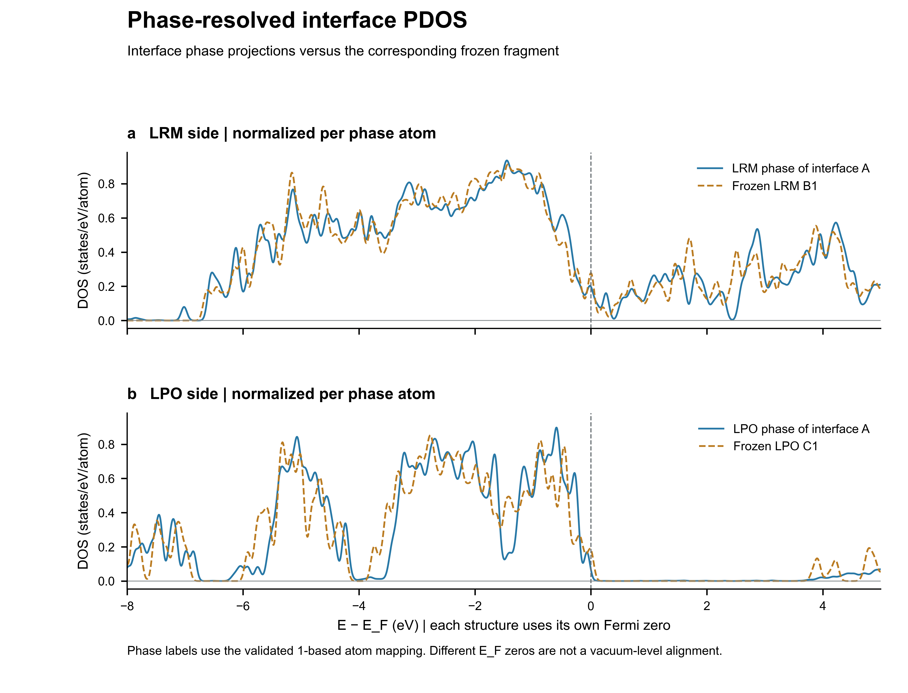

# LRM/LPO 界面 DOS 与 PDOS 联合分析报告

分析日期：2026 年 10 月 23 日  
结合能核验与报告更新：2026 年 10 月 26 日  
源计算：9c0ff19eb2a04c8193d19077add39c9a（父结构与电荷分析任务 d8f1704e2d57414181c5c5b710d1b7cf）  
补算平台状态：succeeded，运行 5254 s，平台记录费用 6.71 元。

## 核心结论

同一组收敛总能量给出的冻结界面结合能为 **-11.437437 eV/模拟晶胞**，定义为 E_bind=E_A−E_LRM−E_LPO。负值表示当前界面构型相对于同晶胞中的两个冻结片段能量更低。该结果尚未做 LCAO 基组叠加误差（BSSE）校正。

三套结构的补算均正常结束并通过 SCF 收敛检查。新 TDOS/PDOS 显示：完整界面在费米能级处的总态密度约为 **25.690 states/eV/胞**；其中 O-p 投影约 **21.995 states/eV/胞（85.6%）**，Mn-d 约 **2.053 states/eV/胞（8.0%）**。Mn-d 费米附近投影呈现明显自旋不对称。按经过验证的原子相区映射，界面费米能级处约 **74.8%** 的相区投影态密度来自 LRM 侧，约 **25.2%** 来自 LPO 侧。

先前差分电荷分析表明，在所选几何中面分区下，LRM 半空间减少 **0.224452 e**，LPO 半空间增加 **0.223884 e**，即该空间分区下净电子重排方向为 LRM→LPO。它与界面费米能级附近态主要投影在 LRM 侧并不矛盾：前者统计空间区间内所有占据电子的密度差，后者描述某一能量附近的态密度，两者不是同一个物理量。

当前计算沿用 1×3×2 k 网格、冻结结构和既定磁性初态。费米附近极窄能级间隔和有限 Gaussian 展宽不支持仅凭本报告给出收敛的金属/绝缘体分类、真空能级带阶或输运结论。

## 计算状态与可靠性

| 体系 | 原子数 | SCF 步数 | 总能量（eV） | E_F（eV） | 总磁矩（μB/胞） | 新 TDOS D(E_F)（states/eV/胞） | 按原子归一化 |
|---|---:|---:|---:|---:|---:|---:|---:|
| 界面 A | 192 | 185 | -115562.406367 | -2.548910 | 34.640131 | 25.690 | 0.1338 |
| 冻结 LRM B1 | 97 | 341 | -85532.955902 | -3.361923 | 33.666269 | 26.903 | 0.2773 |
| 冻结 LPO C1 | 95 | 63 | -30018.013028 | -4.014308 | -0.320741 | 17.514 | 0.1844 |

abacustest 提取的三套结果均为 `normal_end=true` 且 `converge=true`；最后一次密度变化分别为 9.75e-08、9.62e-08、4.61e-08。补算能量、费米能级与总磁矩和原始计算高度一致，说明重算保持了原有数值解与磁性分支。计算过程中有小幅负初始原子电荷警告；ABACUS 随后按总电子数归一化，各任务均收敛，故这里记录为初始化诊断而非终止错误。

ABACUS 原生 TDOS 与 PDOS 来自同次 SCF。XML 中声明的投影轨道数分别为 2372、1347、1025；分别覆盖界面 192、LRM 97、LPO 95 个原子。每个体系的全轨道 PDOS 求和与原生 TDOS 的最大相对差分别为 8.24e-07、1.33e-06、1.54e-06，差异处于输出精度量级。

新原生 TDOS 与先前由 SCF 本征值重建的 DOS 在相同 Gaussian σ=0.05 eV、相同自旋约定下整体吻合；三套体系的总 DOS 平均绝对差分别为 0.0060、0.0058、0.0031 states/eV/胞。峰形和近费米结论一致；后续报告以此次原生 TDOS 与同次 PDOS 为主，保留先前能带采样核查作为独立证据。

### TDOS：三套结构比较

图：三个结构的自旋分辨原生总态密度（下自旋仅作镜像显示）

TDOS 采用 ABACUS 输出，Gaussian 标准差 σ=0.05 eV，能量步长 0.005 eV。绘图能量零点分别为各结构自身的费米能级，按实际原子数归一化。冻结的 LRM 与 LPO 片段分别计算，具有表面和各自费米零点，不能把两条曲线直接解释为真空能级对齐后的带偏移。

此前原始能级核查得到：

- 界面 A：费米能级两侧最近已采样能级间隔 30.6 meV；这只是原 1×3×2 网格上的能级间隔，不是已收敛基本带隙。
- 冻结 LRM B1：上自旋第 356 带在已采样 k 点跨越 E_F（-0.0198 至 +0.0022 eV）。
- 冻结 LPO C1：费米能级两侧最近已采样能级间隔 14.6 meV；这只是原 1×3×2 网格上的能级间隔，不是已收敛基本带隙。

这些采样结果与本次有限展宽下的非零 D(E_F) 应一起看：Gaussian 会将临近能级展宽到 E_F；1×3×2 网格也较稀。因此窄间隔不能据此确认为材料带隙，展宽后的有限 D(E_F) 也不能单独证明本征金属性。此前 DOS 展宽和原始能级审计图见[既有 DOS 报告](../dos_analysis_d8f1704e_20261023/DOS%E7%BB%93%E6%9E%9C%E5%88%86%E6%9E%90%E6%8A%A5%E5%91%8A.md)和[近费米审计图](../dos_analysis_d8f1704e_20261023/dos_near_fermi_audit.png)。

## PDOS：元素与轨道贡献

以下 D(E_F) 来自原生 PDOS 在各体系自身 E_F 处的线性插值。轨道投影按 ABACUS LCAO Mulliken 投影求和，单位为 states/eV/胞；括号中的百分比以该行原生 TDOS 为分母。`其余轨道`为未单列 s/p/d/f 通道的和，使表中各投影回到原生 TDOS。

| 体系 | TDOS | O-p | Mn-d | Co-d | Ni-d | P-p | Li-s | 其余轨道 |
|---|---:|---:|---:|---:|---:|---:|---:|---:|
| 界面 A | 25.690 | 21.995 (85.6%) | 2.053 (8.0%) | 0.270 | 0.182 | 0.032 | 0.191 | 0.967 |
| 冻结 LRM B1 | 26.903 | 20.705 (77.0%) | 2.977 (11.1%) | 1.067 | 0.503 | 0.000 | 0.215 | 1.435 |
| 冻结 LPO C1 | 17.514 | 16.972 (96.9%) | 0.000 (0.0%) | 0.000 | 0.000 | 0.147 | 0.030 | 0.365 |

图：界面、冻结 LRM 与冻结 LPO 的元素分辨 PDOS（上下自旋求和显示）

图：关键轨道投影及其余轨道的明示合计

界面近 E_F 的投影主要来自 O-p；过渡金属 d 态总量较小，但 Mn-d 是最显著的过渡金属分量，且有强自旋不对称。Co-d、Ni-d 的投影在该能量点也可见但明显小于 Mn-d。冻结 LRM 同样以 O-p 和 Mn-d 为主；实际冻结 LPO 片段近 E_F 的 PDOS 则几乎完全由 O-p 贡献，过渡金属轨道在该结构中不存在。这个片段实际组成为 Li₃₅P₁₂O₄₈（少一个 Li 的有限模型），不能直接等同于理想体相 Li₃PO₄。

O-p 与过渡金属 d 投影在部分价带能区重叠，和轨道耦合/杂化相容，但 PDOS 峰位重叠本身不是化学键强度或共价性证明。若需定量键合判断，应另做经验证的 COHP/COOP 或相应键分析。

图：Mn-d、Co-d、Ni-d、O-p、P-p、Li-s 及其余轨道的分自旋 PDOS

该图分别显示两自旋的非负 DOS；它不采用镜像负轴。Mn-d 与 Co/Ni-d 在界面及 LRM 中的自旋通道差异与总磁矩不对称相符，但只代表当前给定初始磁矩和 DFT+U 解，不等同于排除了其他磁序后的磁基态。

### 界面相区分解

完整界面的 1-based 原子映射将 97 个原子划为 LRM、95 个划为 LPO；相区 PDOS 分解均逐原子相加，并与同次界面 TDOS 闭合。以**界面自身的公共费米能级**为零，E_F 处 LRM 与 LPO 相区贡献分别为 19.209 与 6.481 states/eV/胞，占界面总值的 74.8% 与 25.2%。

图：完整界面两相的分区 PDOS 与各自冻结参照（相区原子数归一化）

相区蓝线和冻结参照橙线分别按自己的结构费米能级置零，因而只可比较形状特征；峰位差不能读作两相之间的带偏移。相区 E_F 贡献的百分比仅针对完整界面的同一费米能级，因此没有这一歧义。

## 冻结界面结合能

2026 年 10 月 26 日使用 abacustest 从本次 TDOS/PDOS 计算的原始输出重新提取能量。三套体系均正常结束，SCF 最后残差均小于 1×10⁻⁷；重提取结果与原电荷计算及本报告能量表一致。本次仅做本地提取和相减，未新增远程计算。

| 体系 | 原子数 | 总能量（eV） |
|---|---:|---:|
| 完整界面 A | 192 | -115562.40636720629 |
| 冻结 LRM B1 | 97 | -85532.95590231879 |
| 冻结 LPO C1 | 95 | -30018.01302772072 |

采用负值表示结合有利的约定：

E_bind = E_A − E_LRM − E_LPO = **-11.437437 eV/模拟晶胞**。

若使用正值表示结合能大小的约定，则 E_LRM+E_LPO−E_A = **11.437437 eV/模拟晶胞**；两者只是符号约定不同。报告的小数位用于复现相减，并不代表物理精度已达到微电子伏特。

该值对应 **192 原子界面、97 原子 LRM 与 95 原子 LPO** 的这一套分区。B1+C1 的原子与 A 完全对应，既有几何审计的最大匹配偏差为 0 Å。已重新核验 42 份 STRU、KPT、赝势及轨道文件的源哈希，以及回收 INPUT/STRU/KPT 与提交文件的一致性；因此沿用同晶胞、冻结坐标和一致物理模型的可比性结论。共同设置为 PBE/LCAO、自旋极化、D3(BJ)、100 Ry、1×3×2 k 网格、Gaussian SCF 展宽 0.002 Ry；Mn/Co/Ni 的 U 分别为 3.9/3.3/6.2 eV，LPO 不含这些需要 U 的过渡金属。此处不用早期 96+96 分区或未收敛任务的能量混算。

负值支持当前参照下界面接触在能量上有利。它是**未校正 BSSE 的冻结界面结合能**：片段各自自洽，但未独立弛豫；当前未完成 k 点/基组收敛、其他磁态比较或有限尺寸误差评估。因此不能将它等同于充分弛豫的界面形成能、有限温度自由能，或用来证明结构已达到平衡。

## 与差分电荷及结合能的联合解释

既有差分电荷定义为 Δρ=ρ(界面)−ρ(LRM冻结片段)−ρ(LPO冻结片段)。空间积分以两侧最外层原子间几何中点 x=19.086441 Å 为界：LRM 半空间 ΔN=−0.224452 e，LPO 半空间 ΔN=+0.223884 e；改变分界面会改变数值，测试范围对应 LPO 得电子 0.168–0.257 e。因此应表述为该空间分区下约 0.224 e/模拟晶胞的 LRM→LPO 净转移，而非 Bader 原子电荷或分区无关常数。详见[差分电荷完整报告](../charge_difference_d8f1704e_20261023/%E5%B7%AE%E5%88%86%E7%94%B5%E8%8D%B7%E5%AF%86%E5%BA%A6%E7%BB%93%E6%9E%9C%E5%88%86%E6%9E%90%E6%8A%A5%E5%91%8A_%E5%AE%8C%E6%95%B4%E7%89%88.md)。

PDOS 说明 E_F 附近界面态主要是 O-p 投影，并有 Mn-d 等金属态参与；相区分解显示这些 E_F 态的谱权重更集中在 LRM 侧。差分电荷的 0.224 e 则是对整段占据态作空间积分后的净变化。两者可同时成立，不应把 O-p 在 D(E_F) 中的高占比解释为 O 原子获得了对应 0.224 个电子，也不能用费米点的 DOS 对电荷转移量作积分替代。

结合能补充了能量证据：当前冻结构型相对于选定片段参照能量降低约 11.4374 eV/模拟晶胞；差分电荷给出界面接触后的空间电子重排方向；DOS/PDOS 给出相关能区的投影成分。这三类结果共同描述当前构型的结合与电子结构，但尚不能将能量降低定量归因于某一轨道或那 0.224 e 的净转移，也不能由此推出 Li 迁移势垒或循环性能。

## 标准 Bader 验证补充（2026 年 10 月 26 日）

后续已用标准 Henkelman Bader 1.05 对同一组自旋求和密度计算三套 neargrid 分区，并对界面增加 ongrid 对照。平台任务 `8a1417dff5334de39cc374fa747c2d8d` 正常完成；原子映射、密度哈希、分区索引重新积分和电荷守恒共 658 项完整性检查通过，ACF 与 CUBE 积分最大差约 8.52×10⁻⁶ e。

**逐原子电荷的物理解释验收未通过：完整界面与冻结 LPO 的 12 个 P 原子均得到零电子、零体积区域，且界面 ongrid 对照也复现该问题。** 当前输入为赝价电子密度，没有经验证的核区/全电子参照；程序完成且总电子数守恒，不能保证每个原子得到物理上适当的区域。因此 q=Z_val−N_Bader 给出的 P=+5 e 不能作为可信原子电荷或氧化态证据；相关逐原子表和相区转移量均保留为诊断数据。

这一验证不修改现有差分密度及约 0.224 e 的几何半空间积分、冻结结合能或 DOS/PDOS。若需要正式逐原子电荷，须先核实 ABACUS 与实际赝势支持的核区/全电子参照，再验证 `-ref` 分区和更密密度网格。见[标准 Bader 计算验证报告](../bader_validation_d8f1704e_20261026/Bader_%E8%AE%A1%E7%AE%97%E9%AA%8C%E8%AF%81%E6%8A%A5%E5%91%8A.md)。

## 方法边界与后续计算建议

- 体系为既有冻结结构；LRM/LPO 片段不是各自无表面效应的无限体材料。
- 结合能未做 BSSE/counterpoise 校正，且对应本报告指定的 97+95 原子片段参照。
- k 网格沿用 1×3×2，未完成更密网格的 k 点收敛。费米附近的离散能级和窄峰对网格仍可能敏感。
- 各完整体系的能量轴分别以自身 E_F 为零；未作真空能级或平均静电势对齐，因此不能推出带阶。
- 原始有限 Gaussian 展宽为 σ=0.05 eV；小能隙比该展宽窄时，D(E_F) 取决于展宽处理。
- PDOS 是非正交 LCAO 基组上的 Mulliken 投影，适合判断投影成分；投影值不应视作严格唯一的原子态密度分区。绘图保留程序输出，未把负投影统一截断为零。
- 未比较其他自旋序、SOC 或结构弛豫态；无输运、迁移率或器件电流计算。

## 文件与复现

- 五张独立图分别提供 600 dpi PNG、可编辑 SVG 和 PDF：见 `figures/`。
- 三套 3600 点能量网格的全部元素/轨道、自旋和分相源数据：`processed/*_pdos_channels.csv`；紧凑数组及完整逐体系闭合指标：`processed/*_pdos.npz`、`processed/pdos_validation.json`。
- 费米附近量化表：`processed/pdos_near_fermi_summary.csv`、`.json`。
- 结合能重提取与符号约定：`binding_energy_metrics_20261026.json`、`binding_energy_summary_20261026.json`。
- ABACUS 结果验收：`target_metrics.json`、`abacustest_results.json`、`state/runs/003f4b54c4624ed989a46d03e7bce7dd/download-final/run_status.json`。短超时回收失败后，已用同一 Bohrium 连接器将回收超时提高到 2 小时并成功取得结果；原任务未重提。
- 可复现后处理：`extract_pdos.py`、`summarize_pdos.py`、`plot_pdos.py`、`write_combined_report.py`。
- 原始回收结果包含三套 OUT 目录和 1.53 GB 平台归档，保存在 `state/runs/003f4b54c4624ed989a46d03e7bce7dd/download-final/`。

